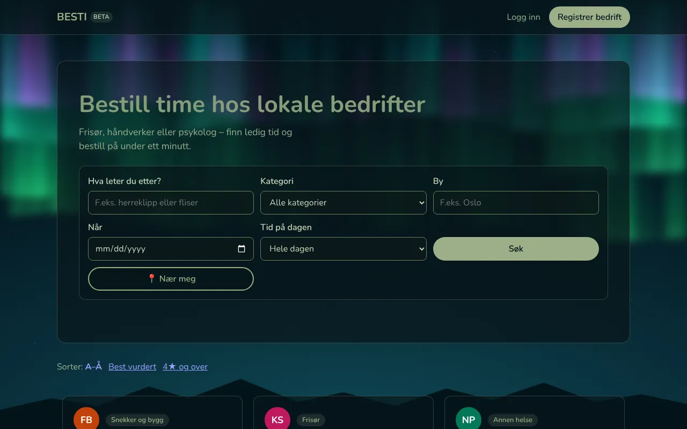
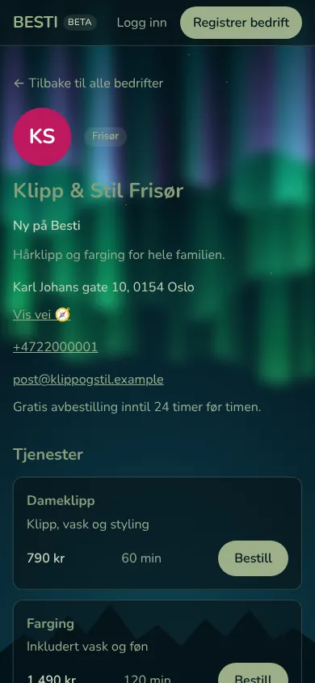
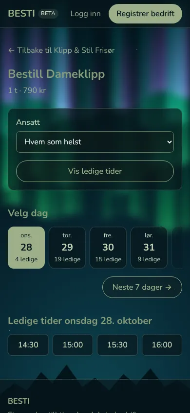
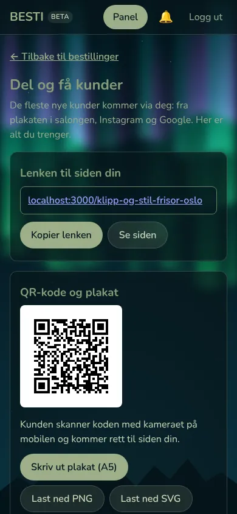
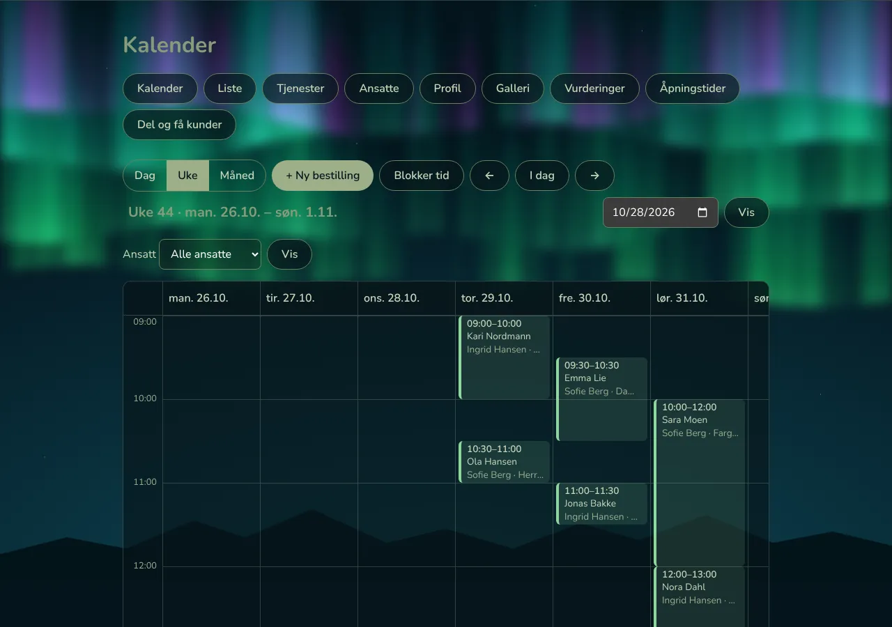

# BESTI

**Bestill med din besti.** BESTI is an online booking app for local service businesses in Norway:
hair salons, beauty, health, craftsmen and more. Customers find a business, see free times and book in
under a minute. Businesses get a calendar, their own booking page and a QR poster for the counter.

Live at **[bestiapp.no](https://bestiapp.no)** (beta, starting in Gjøvik).

<p>
  
</p>
<p>
  
  
  
</p>
<p>
  
</p>

## Features

**For customers**
- Search by service, category, city, day and time of day, or businesses near me (map)
- Business pages with services, prices, staff, opening hours, photos and verified reviews
- Free times for the next 7 days, "anyone" or a chosen employee, longer visits for hourly services
- Customer account with e-mail and password or "Fortsett med Google"
- Min Besti: upcoming visits, cancel within the business's free-cancel window,
  accept or decline a new time, add to calendar (.ics), reviews only after a real visit
- E-mail confirmations and a reminder the day before, notification bell
- Favoritter: save a business with the heart and book the same service again in one tap
- Data export and account deletion (GDPR)

**For businesses**
- Sign-up with a check in the Brønnøysund register and manual approval
- Calendar (day, week, month) per employee, manual bookings for phone and walk-in customers,
  move, cancel, "Møtte ikke", blocked time
- Services (fixed price, per hour, per m², by agreement), employees, opening hours, logo and gallery
- Booking rules: auto-confirm or confirm each booking, free cancellation from 0 to 48 hours
- A short page address (`bestiapp.no/salong-kari-gjovik`), QR code, printable A5 poster and
  ready texts for Google, Instagram and Facebook
- "Kom i gang" checklist for new businesses
- Statistikk: visits, estimated revenue, new and returning customers, busy days and hours, top services
  and employees, with tips from the business's own numbers; a short Ukerapport by e-mail every Monday

**For the BESTI team**
- /admin (only the e-mails in `Admin:Emails`): approve or reject new businesses, see who needs help
  getting started, contact details, a private note per business and the newest reviews

## Tech stack

| Part | Technology |
|---|---|
| API | C# / ASP.NET Core (.NET 10), minimal APIs, ASP.NET Core Identity (bearer tokens) |
| Database | SQL Server 2022, Entity Framework Core 10 with migrations |
| Web | Next.js (App Router), React, TypeScript, plain CSS modules, server components and server actions |
| Tests | xUnit (service tests and HTTP tests with `WebApplicationFactory`) |
| Hosting | Docker Compose on a Hetzner server, Caddy, Cloudflare, nightly backups |
| CI/CD | GitHub Actions: build, test, lint, Docker images, automatic deploy with rollback |
| E-mail | Brevo SMTP through an outbox table in the database, sent in the background with retries (Mailpit locally) |

The web app only shows data; all rules live in the API, so a mobile app can use the same API later.

## Architecture

The backend follows the Onion architecture:

```
besti2.Domain           entities and enums, no dependencies
besti2.Application      DTOs, interfaces and rules (what the app does)
besti2.Infrastructure   EF Core, Identity, e-mail, images, Brønnøysund, Geonorge (how it is done)
besti2                  the API: endpoints, authorization, rate limiting, background jobs
besti2.Tests            xUnit tests
web/                    Next.js website
deploy/                 server files: docker-compose.prod.yml, Caddyfile, deploy and backup scripts
docs/                   privacy overview (GDPR art. 30) and screenshots
```

Some choices worth knowing:
- Times are stored in UTC and shown in Europe/Oslo.
- Enums are stored as strings; user-facing text is Norwegian bokmål, code is English.
- The login token lives in an httpOnly cookie set by a Next.js server action, never in JavaScript.
- Search and booking are rate limited per visitor IP.

## Running locally

Requirements: .NET 10 SDK, Node.js 22, Docker.

1. Start SQL Server and Mailpit (test inbox at http://localhost:8025):

   ```bash
   cp .env.example .env        # choose a local SA password
   docker compose up -d
   ```

2. Tell the API where the database is (kept outside the repo):

   ```bash
   dotnet user-secrets --project besti2 set "ConnectionStrings:DefaultConnection" \
     "Server=localhost,1433;Database=besti2;User Id=sa;Password=<your password>;TrustServerCertificate=True"
   ```

3. Create the database and start the API (http://localhost:5156):

   ```bash
   dotnet tool install --global dotnet-ef
   dotnet ef database update -p besti2.Infrastructure -s besti2
   dotnet run --project besti2
   ```

4. Start the website (http://localhost:3000):

   ```bash
   cd web
   npm ci
   npm run dev
   ```

"Fortsett med Google" is optional: put `GOOGLE_CLIENT_ID` and `GOOGLE_CLIENT_SECRET` in `web/.env.local` and
`Google:ClientId` in the API's user secrets. Without them the button is hidden.

The database comes with three demo businesses. In development each has an owner account,
e.g. `eier@klippogstil.example` with the password `Test123!`.

## Tests

```bash
dotnet test                         # API
cd web && npx tsc --noEmit && npm run lint
```

Every pull request runs the same checks in GitHub Actions. A merge to `main` builds Docker images and
deploys them; the deploy backs up the database first and rolls back automatically if the new version
is not healthy.

## Privacy

BESTI is built for GDPR from the start: customer accounts are required for booking, old bookings are
anonymized after 3 years, users can export and delete their data, and visit statistics are cookie-free.
The processing overview is in [docs/personvern-oversikt.md](docs/personvern-oversikt.md) and the public
privacy policy is at [bestiapp.no/personvern](https://bestiapp.no/personvern).

## Author

Made by Michał Szczepański in Gjøvik, Norway. Questions: post@bestiapp.no
